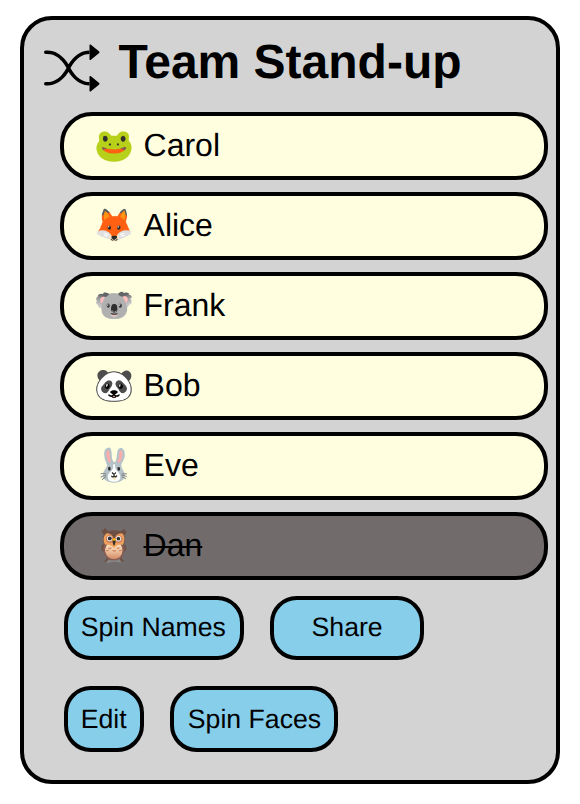
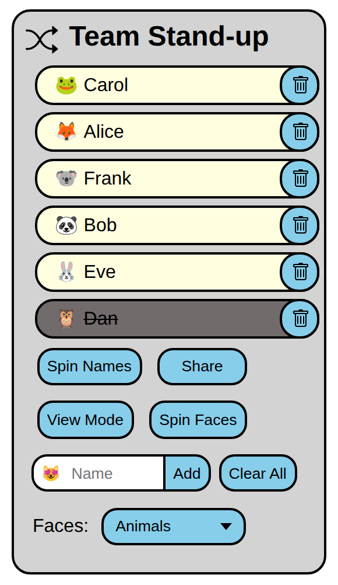
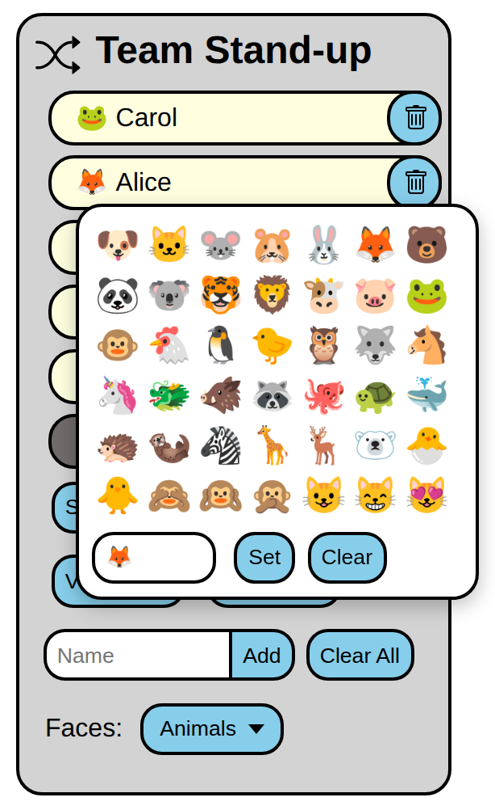

# Name Spinner
Created to quickly spin a list of names of team members
to see what order we can go in for stand-up.

The fun part about it is that it stores all of its data
in the URI, no cookies or files, so you can bookmark it
with data encoded in the URI.  We often paste it in our team
channel each time we spin it.

Try it at https://namespinner.github.io

  
  
  

## What it does
- Shuffles a list of names into a random order.
- Lets you cross out people who are away so they're left out of the spin.
- Can give each person a fun face emoji: animals, critters, food, moods,
  or a mix of all of them.
- Copies the spun list, with today's date and a link back, so you can
  paste it into chat.
- Keeps everything in the link: the names, who's crossed out, the title,
  the faces and when it was last spun. Bookmark or share the link and
  it opens exactly the same list. Your last list is also remembered in
  your browser, so opening the app with no link brings it back.
- Works offline and can be installed to your phone or desktop home screen.

## How to use it

### Set up your list
1. Press **Edit** to switch to edit mode (the button then reads **View Mode**).
2. Type a name in the **Name** box and press **Add**. Repeat for everyone.
3. Click the title at the top to rename the list, e.g. "Team Stand-up".

In edit mode you can also:
- **Rename** someone by clicking their name.
- **Reorder** names by dragging them.
- **Remove** someone with the trash can button.
- **Clear All** to empty the list and start over. It asks you to confirm
  first, and the browser's Back button undoes it.

Press **View Mode** when you're done.

### Spin
- Press **Spin!** to shuffle the names into a new order.
- Click a name to cross it out if that person is away. Crossed-out names
  stay at the bottom and aren't included in the spin. Click it again to
  bring them back.
- Press **Share** to copy the list to the clipboard. The button flashes
  "Copied ✓", then you can paste the list into your team chat. It includes
  the date and a link for next time.

### Faces
1. In edit mode, choose **Animals**, **Critters**, **Food** or **Moods**
   from the **Faces** dropdown. Everyone gets a random face.
   **All Categories** mixes faces from all of them.
2. Press **Spin Faces** to give everyone new random faces. With faces on,
   the **Spin!** button is called **Spin Names**.
3. Click someone's face to pick a different one, or type any emoji in the
   **Custom** box and press **Set**. **Clear** removes it.
4. When adding a name, the face at the start of the **Name** box is the
   random face they'll get. Click it to pick a different one. After each
   **Add** a new random face is ready for the next name.

Choose **None** to turn faces off. You can also give someone a face by
starting their name with an emoji, like "🐶 Alice"; the emoji is moved
into their face automatically.

### Save and share
Everything lives in the address bar, so to keep your list just bookmark
the page or paste the link somewhere. Anyone who opens the link sees
the same list.
